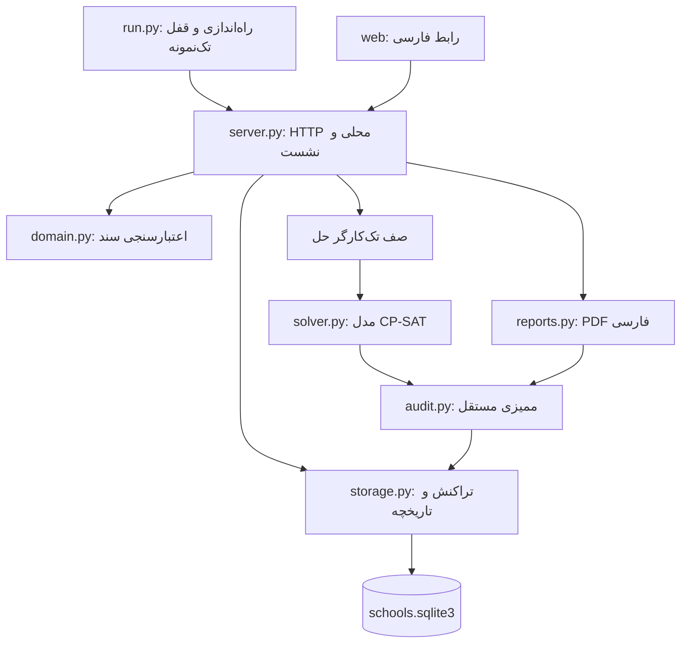
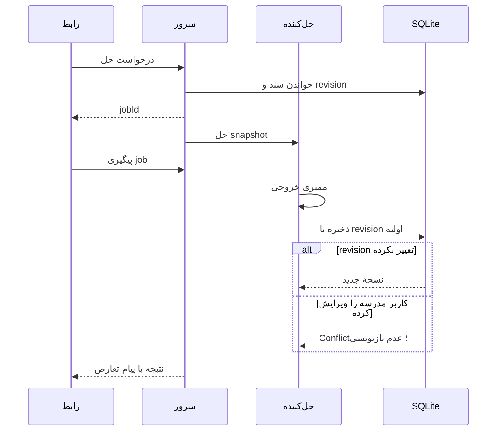

# معماری و تصمیم‌های طراحی

[صفحهٔ اصلی](../README.md) · [قالب داده و API](DATA_AND_API.md) · [توسعه و انتشار](DEVELOPMENT.md)

## محدودهٔ محصول

هم‌درس یک برنامهٔ محلی تک‌کاربره برای زمان‌بندی مدرسه است. مرورگر نقش رابط را دارد؛ Python مسئول اعتبارسنجی، حل، ذخیره و PDF است. وب‌سایت عمومی، سرویس ابری، حساب کاربری یا همگام‌سازی چنددستگاهی در این نسخه وجود ندارد.

این انتخاب از نیاز به نصب و مدیریت سرور مستقل و زنجیرهٔ build فرانت جلوگیری می‌کند. در نسخهٔ ویندوز، Python و کتابخانه‌های لازم داخل بستهٔ اجرایی قرار می‌گیرند؛ مرورگر پیش‌فرض سیستم رابط را نشان می‌دهد.

## نقشهٔ اجزا

| بخش | مسئولیت | چیزی که نباید به آن منتقل شود |
| --- | --- | --- |
| `run.py` | آرگومان‌های اجرا، مسیر داده، قفل پردازش، بازکردن مرورگر، خاموش‌شدن | قواعد زمان‌بندی |
| `domain.py` | قرارداد نسخه‌دار، کنترل شناسه و ارجاع، گسترش جلسات و دامنهٔ قید | HTTP و دسترسی مستقیم به DB |
| `solver.py` | ساخت متغیر و قید و هدف، فراخوانی OR-Tools | نوشتن مستقیم فایل مدرسه |
| `audit.py` | بازسازی اشغال‌ها و بررسی نتیجه بدون متغیرهای حل‌کننده | اعتماد به پرچم اعتبار ورودی |
| `storage.py` | SQLite، تاریخچه، کنترل revision و تراکنش | تصمیم دربارهٔ ترجیح‌های مدرسه |
| `server.py` | تبدیل درخواست به عملیات، نشست، صف حل و خطاهای HTTP | تعریف مستقل دیگری از قواعد دامنه |
| `reports.py` | ممیزی قبل از خروجی، حروف‌چینی فارسی و تولید PDF | اصلاح خودکار اطلاعات مدرسه |
| `web/app.js` | وضعیت رابط، فرم‌ها، جدول، ارتباط API و دانلود | فرض اینکه ذخیرهٔ مرورگر پایگاه دادهٔ اصلی است |

## مدل سند

هر مدرسه یک سند JSON نسخه‌دار است و مجموعه‌های کلاس، درس، دبیر، تعریف جلسه، قید و آخرین نتیجه را در خود دارد. در SQLite هر سند در یک ردیف نگهداری می‌شود؛ نیاز به joinهای متعدد یا migration ده‌ها جدول وجود ندارد. روابط داخل سند در لایهٔ دامنه اعتبارسنجی می‌شوند.

تعریف جلسه‌ای با `count=3` به سه رویداد با شناسه‌های پایدار `lessonId:0` تا `lessonId:2` گسترش پیدا می‌کند. قید می‌تواند به کل تعریف یا یک رخداد مشخص ارجاع بدهد. تغییر تعداد جلسات با ارجاع‌های موجود کنترل می‌شود.

واحد داخلی زمان نیم‌زنگ است. زنگ کامل از نیمهٔ اول شروع می‌شود و دو نیمه را اشغال می‌کند. ساعت واقعی کلاس‌ها بر حسب دقیقه از ابتدای روز نگهداری می‌شود. زمان‌بندی تداخل دبیر بر مبنای ساعت واقعی است، نه صرفاً شمارهٔ زنگ.

## مدل حل

برای هر ترکیب ممکنِ رویداد، دبیر مجاز و شروع زمانی، یک متغیر Boolean ساخته می‌شود. هر رویداد دقیقاً یک گزینه دارد. اشغال هر نیم‌زنگ کلاس حداکثر یک جلسه است. برای دبیران، بازه‌های زمانی اختیاری در هر روز با `NoOverlap` کنترل می‌شوند.

کلاس تجمیعی یک رویداد است و همهٔ کلاس‌های عضو را اشغال می‌کند. اگر زنگ‌بندی اعضا متفاوت باشد، برای دبیر از کوچک‌ترین شروع تا بزرگ‌ترین پایان اعضا یک بازهٔ پوشاننده ساخته می‌شود؛ این انتخاب محافظه‌کارانه جلوی تداخل را می‌گیرد.

حضور دبیر به قید عمومی زمان مجاز تبدیل می‌شود. قید کاربر نیز یک پرچم فعال‌کننده در مدل دارد:

- الزام: پرچم به‌عنوان assumption اجباری است.
- ترجیح: رعایت‌نشدن آن جریمه‌ای به اندازهٔ وزن دارد.
- غیرفعال: وارد مدل نمی‌شود.

هدف مجموع جریمهٔ قیود نرم به‌علاوهٔ جریمهٔ تغییر زمان/دبیر جلسات قبلی است. وزن‌دهی جمعی است و بهینه‌سازی چندمرحله‌ای با اولویت مطلق اجرا نمی‌شود. هر قید نرم یک جریمهٔ کلی دارد؛ مثلاً یک قید بدون فاصله به ازای هر فاصله جداگانه جریمه نمی‌شود.

وقتی مدل ناممکن باشد، assumptionهای مرتبط برای توضیح تعارض استخراج می‌شوند. این مجموعه ممکن است از مجموعهٔ کمینه بزرگ‌تر باشد. ظرفیت بیش‌ازحد یک کلاس پیش از حل با پیام مستقیم گزارش می‌شود.

## ممیزی مستقل

ممیزی به schedule نهایی و سند مدرسه نگاه می‌کند و از متغیرهای Boolean حل‌کننده استفاده نمی‌کند. موارد زیر بررسی می‌شوند:

1. هر رویداد دقیقاً یک‌بار آمده باشد.
2. شروع جلسه و دبیر انتخابی معتبر باشند.
3. اشغال کلاس‌ها تداخل نداشته باشد.
4. ساعت واقعی دبیر در جلسات مختلف هم‌پوشانی نداشته باشد.
5. تمام قیود الزامی رعایت شده باشند و وضعیت ترجیح‌ها محاسبه شود.

ممیزی و حل‌کننده از تعریف مشترک رویداد، دامنهٔ انتخاب و بازهٔ واقعی در `domain.py` استفاده می‌کنند؛ استقلال ممیزی به معنی پیاده‌سازی جداگانهٔ بررسی خروجی از فرمول‌بندی CP-SAT است، نه بی‌ارتباط‌بودن کامل همهٔ توابع.

قبل از ذخیرهٔ نتیجهٔ حل، ورود برنامهٔ جاری از فایل و تولید PDF، اعتبار نتیجه بررسی می‌شود. در صورت شکست ممیزی حل، نتیجه به‌عنوان برنامهٔ معتبر ذخیره نمی‌شود.

## ذخیره و هم‌زمانی

برای هر عملیات، اتصال SQLite جداگانه باز و بسته می‌شود. نوشتن با تراکنش و `synchronous=FULL` انجام می‌شود. ذخیره از `BEGIN IMMEDIATE` و revision موردانتظار استفاده می‌کند؛ در نتیجه دو پنجره نمی‌توانند بی‌صدا تغییر یکدیگر را بازنویسی کنند.

هر ذخیره، سند قبلی را در جدول `history` قرار می‌دهد و فقط ۳۰ نسخهٔ قبلی را نگه می‌دارد. نسخهٔ جاری در جدول `schools` است. تاریخچه در همان فایل اصلی است و پشتیبان مستقل محسوب نمی‌شود.

صف حل یک کارگر دارد. وضعیت job در حافظه است و با خروج از پردازش از بین می‌رود؛ نتیجهٔ ذخیره‌شده در DB باقی می‌ماند. `sessionStorage` صرفاً برای ادامهٔ پیگیری job در بازخوانی صفحه است. `localStorage` فقط انتخاب مدرسه را نگه می‌دارد.

ویرایش عادی سند، نتیجهٔ قبلی را با `stale=true` حفظ می‌کند. این نتیجه برای مشاهده و راهنمای حل بعدی مفید است، اما PDF آن مسدود می‌شود. وقتی مدرسه با نتیجهٔ stale از فایل وارد شود، نتیجه کنار گذاشته می‌شود.

## اجرای محلی و مرز دسترسی

سرور فقط روی `127.0.0.1` اجرا می‌شود؛ پورت پیش‌فرض خودکار انتخاب می‌شود. URL آغازین یک توکن تصادفی دارد و با یک redirect به cookie دارای `HttpOnly` و `SameSite=Strict` تبدیل می‌شود. آدرس و توکن در لاگ درخواست نوشته نمی‌شوند.

Host و Origin کنترل می‌شوند. پاسخ‌ها `no-store`، `nosniff` و سیاست CSP دارند. فایل‌های static باید داخل پوشهٔ `web` باقی بمانند. درخواست POST باید JSON و حداکثر ۸٬۰۰۰٬۰۰۰ بایت باشد.

این سازوکار برای برنامهٔ محلی است؛ جای طراحی احراز هویت چندکاربره، HTTPS یا سخت‌سازی سرویس عمومی را نمی‌گیرد. فایل `session.url` قابلیت بازکردن نشست جاری را دارد و نباید در پشتیبان قابل‌اشتراک یا Git ثبت شود. پایگاه داده رمزگذاری نشده است؛ سطح دسترسی آن تابع حساب سیستم‌عامل است.

قفل پردازش در پوشهٔ داده از دو اجرای مستقل روی همان داده جلوگیری می‌کند. اجرای دوباره معمولاً مرورگر را به نشست قبلی هدایت می‌کند. خاموش‌شدن برنامه علامت لغو را به حل‌کننده می‌دهد و منابع و قفل آزاد می‌شوند.

## PDF و بسته‌بندی

PDF در حافظه ساخته می‌شود. ReportLab جدول‌ها را می‌سازد؛ Arabic Reshaper و الگوریتم BiDi برای اتصال حروف و ترتیب فارسی استفاده می‌شوند. فونت تعبیه‌شده همراه برنامه و مجوز آن داخل `web/assets` است.

PyInstaller برنامه و داده‌های `web` و کتابخانه‌ها را بسته‌بندی می‌کند. Inno Setup میان‌بر و حذف‌کننده می‌سازد. DB در پوشهٔ دادهٔ حساب کاربر است و به مسیر نصب وابسته نیست.

## توسعهٔ بعدی

برای افزودن نوع قید، تعریف و اعتبارسنجی آن، فرمول‌بندی حل، ممیزی مستقل، فرم رابط و آزمایش‌ها باید با هم تغییر کنند. برای تغییر قالب فایل، نسخهٔ schema و سیاست migration باید صریح باشد؛ نسخهٔ ناشناخته نباید با حدس پذیرفته شود. جزئیات در [راهنمای توسعه](DEVELOPMENT.md) آمده است.
